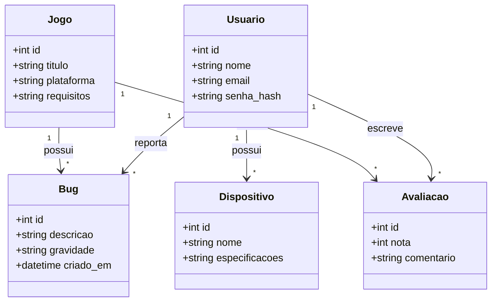
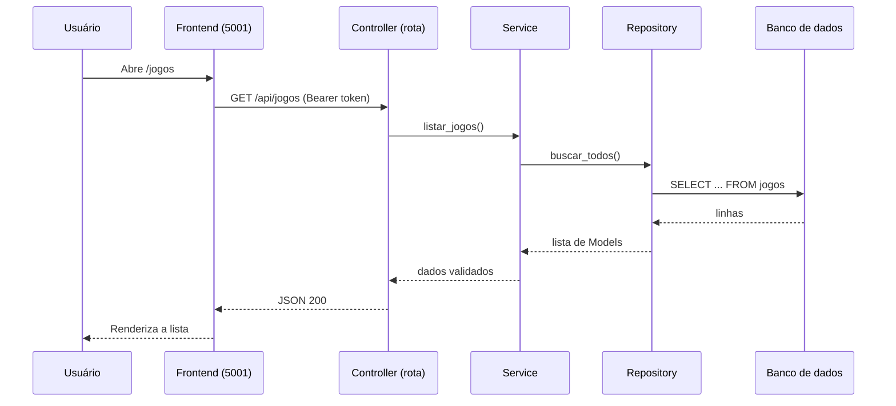
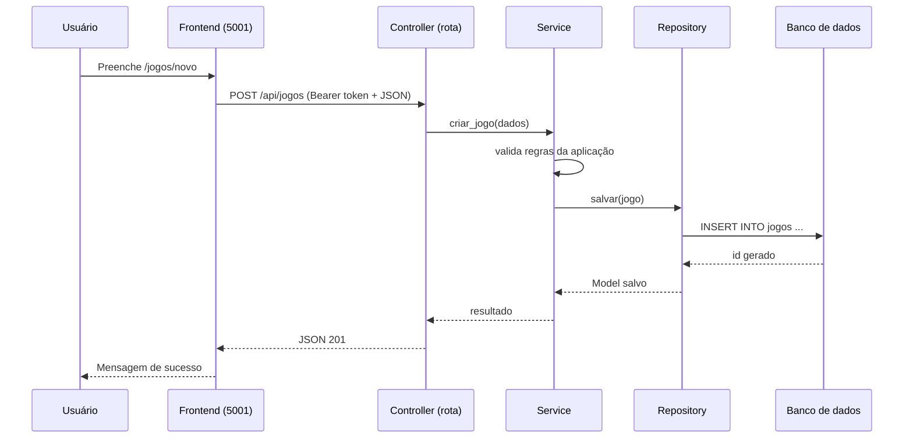
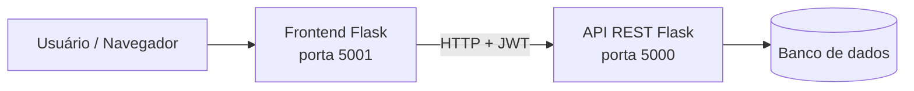

# LaaC Lab (Bugômetro)

> **Descubra antes de jogar.** Plataforma para gamers encontrarem informações confiáveis sobre bugs, desempenho e compatibilidade de jogos **antes** de comprar ou instalar.

🌐 Site: https://clabautsch.github.io/LAAC-LAB/

**Turma:** [3c2] · **Disciplina:** [Projeto de Software] · **Professor(a):** [Gleison]

## Integrantes

| Nome | Matrícula |
|---|---|
| Clara Santa Bárbara Utsch | 22400109 |
| Luís Henrique Rocha Brandão | 22402284 |
| Arthur Mariano Gonçalves Barroso | 22400567 |
| Arthur Assis dos Santos | 22402209 |
| Aureo Henrique Badaró de Carvalho | 22400273 |

---

## Sumário

1. [Sobre o projeto](#1-sobre-o-projeto)
2. [Casos de uso](#2-casos-de-uso)
3. [Modelo de domínio](#3-modelo-de-domínio)
4. [Fluxogramas](#4-fluxogramas)
5. [Arquitetura e organização do código](#5-arquitetura-e-organização-do-código)
6. [Funcionalidades principais (não CRUD)](#6-funcionalidades-principais-não-crud)
7. [Persistência e consultas](#7-persistência-e-consultas)
8. [Tecnologias](#8-tecnologias)
9. [Como executar](#9-como-executar)
10. [Rotas da API](#10-rotas-da-api)
11. [Testes](#11-testes)
12. [Bônus](#12-bônus)
13. [Solução de problemas](#13-solução-de-problemas)

---

## 1. Sobre o projeto

### Problema

Muitos gamers têm dificuldade de encontrar informações confiáveis e centralizadas sobre jogos: desempenho, bugs, compatibilidade e opiniões de outros jogadores. Os dados ficam espalhados em sites, fóruns e vídeos, o que gera perda de tempo e frustração. Com isso, jogadores acabam comprando jogos incompatíveis com seus dispositivos ou enfrentando bugs sem aviso prévio.

### Solução

O **LaaC Lab** centraliza essas informações em um ambiente confiável e colaborativo. O **Bugômetro** permite verificar bugs, desempenho e compatibilidade antes da compra ou instalação, com base em dados e experiências reais da comunidade.

### Público-alvo

Gamers e amantes de jogos (PC, console e mobile) que querem decidir melhor o que comprar, instalar ou jogar.

### Pilares do produto

| Pilar | Descrição |
|---|---|
| **Informação e Atualizações** | Notícias, guias, requisitos de jogos e atualizações |
| **Comunidade e Feedback** | Espaço para experiências, opiniões, dúvidas e relatos sobre jogos |
| **Bugômetro e Biblioteca Gamer** | Ajuda o usuário a decidir se vale a pena instalar, comprar ou jogar um jogo |

### Modelo de negócio

*Freemium*: comunidade, conteúdo informativo e consulta básica ao Bugômetro são gratuitos. O plano premium (planejado) inclui análises detalhadas de desempenho, alertas personalizados, filtros por dispositivo e relatórios de compatibilidade.

---

## 2. Casos de uso

> ⚠️ Ajuste a tabela ao que está **realmente implementado**. Cada caso deve ter a tela correspondente.

| # | Caso de uso | Objetivo | Tela / rota do frontend | Status |
|---|---|---|---|---|
| UC01 | Cadastrar-se e entrar | Acessar a plataforma com segurança (JWT) | `/registro`, `/login` | ✅ |
| UC02 | Consultar o catálogo de jogos | Encontrar e ver detalhes de um jogo | `/jogos`, `/jogos/<id>` | ✅ |
| UC03 | Cadastrar e manter jogos | Ampliar e manter o catálogo | `/jogos/novo`, `/jogos/<id>/editar` | ✅ |
| UC04 | [Reportar bug / avaliar jogo] | Alimentar a comunidade com relatos | `[rota]` | [✅/🚧] |
| UC05 | [Consultar o Bugômetro] | Decidir antes de comprar | `[rota]` | [✅/🚧] |
| UC06 | Gerenciar perfil | Ver, editar e excluir a própria conta | `/perfil`, `/perfil/editar`, `/perfil/excluir` | ✅ |

**Legenda:** ✅ implementado · 🚧 em desenvolvimento · 📌 planejado

<!-- Inclua aqui prints das telas:  -->

---

## 3. Modelo de domínio

A API expõe CRUD completo para **18 entidades** do domínio. O diagrama abaixo mostra as principais; ajuste atributos e relacionamentos ao código.



> 📌 Substituir pelo diagrama real (ou exportar a imagem para `docs/img/diagrama-classes.png`). Lista completa das 18 entidades: [preencher].

---

## 4. Fluxogramas

### 4.1 Recuperação de dados (ex.: listar jogos)



### 4.2 Entrada de dados (ex.: cadastrar jogo)



---

## 5. Arquitetura e organização do código

O sistema tem **dois servidores independentes**: a **API REST** e o **frontend**, que consome a API por requisições HTTP.



### Camadas da API

| Camada | Responsabilidade |
|---|---|
| **Controller** | Recebe a requisição HTTP (rotas/Blueprints), valida entrada e devolve a resposta |
| **Service** | Executa o caso de uso e as regras da aplicação |
| **Repository** | Realiza as operações e consultas no banco (SQL via SQLAlchemy) |
| **Model** | Representa os dados (entidades ORM) |

### Estrutura de diretórios

> ⚠️ Confirme os nomes das pastas com o repositório e ajuste.

```text
LAAC-LAB/
├── api-flask-laaclab/          # API REST (porta 5000)
│   ├── app/
│   │   ├── controllers/        # Blueprints / rotas
│   │   ├── services/           # Regras de aplicação e casos de uso
│   │   ├── repositories/       # Consultas e acesso ao banco
│   │   ├── models/             # Models SQLAlchemy
│   │   └── schemas/            # Schemas de entrada e saída
│   ├── .env.example
│   ├── requirements.txt
│   └── wsgi.py
├── frontend/
│   └── login/                  # Frontend Flask (porta 5001)
│       ├── app.py
│       ├── api_client.py       # Cliente HTTP que consome a API
│       ├── templates/
│       └── requirements.txt
└── README.md
```

### Separação entre frontend e API

O frontend **não acessa o banco**. Toda operação passa pela API, via `frontend/login/api_client.py`. O token JWT retornado no login é guardado na sessão do Flask e enviado em cada chamada como `Authorization: Bearer <token>`. O endereço da API é configurável pela variável de ambiente `API_BASE_URL` (padrão: `http://127.0.0.1:5000`).

---

## 6. Funcionalidades principais (não CRUD)

> ⚠️ Liste aqui as **4 funcionalidades principais que não são CRUD** usadas na demonstração. Cadastrar, listar, consultar, editar e excluir não contam.

| # | Funcionalidade | Ação do usuário | Resultado no sistema |
|---|---|---|---|
| 1 | [Autenticação com JWT] | Faz login | Token gerado e sessão criada |
| 2 | [Reportar um bug em um jogo] | Envia relato | Bug registrado e indicadores atualizados |
| 3 | [Cálculo do Bugômetro] | Abre um jogo | Métrica de qualidade calculada |
| 4 | [Verificar compatibilidade por dispositivo] | Escolhe o dispositivo | Resultado de compatibilidade |

---

## 7. Persistência e consultas

- **ORM:** as operações de CRUD usam **SQLAlchemy** (Models em `[caminho dos models]`).
- **SQL na camada Repository:** as consultas ficam em `[caminho dos repositories]`, por exemplo:

```python
# Exemplo (ajuste ao código real)
def buscar_por_titulo(self, termo):
    return (
        db.session.query(Jogo)
        .filter(Jogo.titulo.ilike(f"%{termo}%"))
        .order_by(Jogo.titulo)
        .all()
    )
```

- **Migrations:** `[ferramenta / pasta]`.
- **Dados de exemplo:** `flask seed-db` popula o banco com dados de teste.

---

## 8. Tecnologias

| Área | Tecnologias |
|---|---|
| Linguagem | Python 3.12 |
| API | Flask, SQLAlchemy, JWT (SimpleJWT/JWT), Swagger (drf-spectacular) `[confirmar]` |
| Frontend | Flask (templates), HTML, CSS |
| Banco de dados | SQLite (desenvolvimento) · PostgreSQL / MySQL `[confirmar]` |
| Infra | Docker, Docker Compose, Redis, Celery, Gunicorn `[usar apenas o que estiver ativo]` |
| Ferramentas | Postman, Cursor, Visual Studio Code, DBeaver |

> ⚠️ Remova desta tabela o que não é usado pela versão atual, para não gerar dúvida na banca.

---

## 9. Como executar

### Pré-requisitos

- Python **3.12** (verifique com `python --version`)
- Git
- Dois terminais abertos (um para a API, outro para o frontend)

### 9.1 Clonar o repositório

```bash
git clone https://github.com/ClabaUtsch/LAAC-LAB.git
cd LAAC-LAB
```

### 9.2 API (`api-flask-laaclab/`) – porta 5000

**Windows (PowerShell):**

```powershell
cd api-flask-laaclab
python -m venv venv
.\venv\Scripts\Activate.ps1
pip install -r requirements.txt
Copy-Item .env.example .env
flask init-db      # cria as tabelas
flask seed-db      # (opcional) popula dados de exemplo
python wsgi.py     # API em http://127.0.0.1:5000
```

**Linux / macOS:**

```bash
cd api-flask-laaclab
python3 -m venv venv
source venv/bin/activate
pip install -r requirements.txt
cp .env.example .env
flask init-db
flask seed-db
python wsgi.py
```

Edite o arquivo `.env` se precisar trocar a chave secreta ou a conexão com o banco.

### 9.3 Frontend (`frontend/login/`) – porta 5001

Em **outro terminal**, com a API já rodando:

**Windows (PowerShell):**

```powershell
cd frontend/login
python -m venv venv
.\venv\Scripts\Activate.ps1
pip install -r requirements.txt
python app.py      # telas em http://127.0.0.1:5001
```

**Linux / macOS:**

```bash
cd frontend/login
python3 -m venv venv
source venv/bin/activate
pip install -r requirements.txt
python app.py
```

Para apontar o frontend para outra API:

```powershell
$env:API_BASE_URL = "http://127.0.0.1:5000"   # PowerShell
```

```bash
export API_BASE_URL="http://127.0.0.1:5000"   # Linux / macOS
```

### 9.4 Fluxo básico de uso

1. Acesse http://127.0.0.1:5001/registro e crie uma conta.
2. Faça login em `/login`.
3. Use o menu superior para acessar **Jogos**, **Usuários** e **Meu perfil**.

### 9.5 Com Docker (opcional)

> Inclua esta seção **somente** se o `docker-compose.yml` estiver funcionando.

```bash
docker compose up --build
```

---

## 10. Rotas da API

CRUD completo para as 18 entidades do domínio. A tabela completa fica em [`api-flask-laaclab/README.md`](api-flask-laaclab/README.md). Exemplos:

| Model | Rotas da API | Telas no frontend |
|---|---|---|
| `Usuario` | `POST /api/auth/register`, `POST /api/auth/login`, `GET /api/usuarios`, `GET/PUT/DELETE /api/usuarios/<id>` | `/registro`, `/login`, `/usuarios`, `/perfil`, `/perfil/editar`, `/perfil/excluir` |
| `Jogo` | `GET /api/jogos`, `GET /api/jogos/<id>`, `POST /api/jogos`, `PUT /api/jogos/<id>`, `DELETE /api/jogos/<id>` | `/jogos`, `/jogos/<id>`, `/jogos/novo`, `/jogos/<id>/editar`, `/jogos/<id>/excluir` |

Escrever (cadastrar, editar, excluir) exige autenticação: envie `Authorization: Bearer <token>`.

---

## 11. Testes

```bash
cd api-flask-laaclab
pytest          # [confirmar comando e pasta tests/]
```

---

## 12. Bônus

| Bônus | Status |
|---|---|
| Integração funcional de IA como serviço | [sim / não] |
| Frontend e API hospedados | [sim, link / não] |
| Termos de consentimento com a decisão do usuário registrada | [sim / não] |

---

## 13. Solução de problemas

**A ativação do venv é bloqueada no PowerShell** (erro sobre execução de scripts desabilitada). Libere só para a sessão atual e ative de novo:

```powershell
Set-ExecutionPolicy -Scope Process -ExecutionPolicy Bypass
.\venv\Scripts\Activate.ps1
```

**`pip install -r requirements.txt` falha.** Confirme que o venv está ativo (o terminal mostra `(venv)`) e que o Python é o 3.12. Se persistir, atualize o pip: `python -m pip install --upgrade pip`.

**O frontend abre, mas não carrega dados.** Confirme que a API está rodando na porta 5000 e que `API_BASE_URL` aponta para ela.

**`flask init-db` não encontra o app.** Rode o comando dentro de `api-flask-laaclab/`, com o venv ativo.

---

## Licença

[Definir, por exemplo MIT, ou "Projeto acadêmico"]
